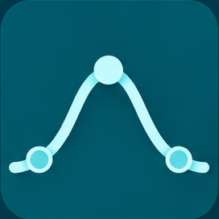
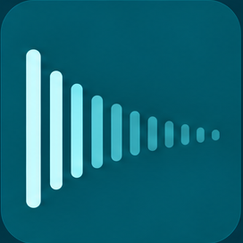
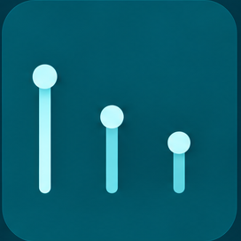
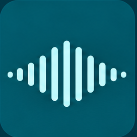
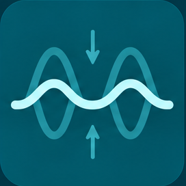
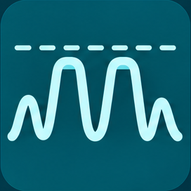
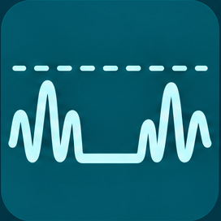
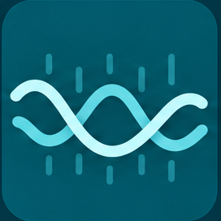
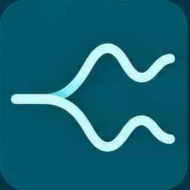
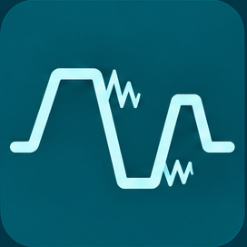

<!-- Keep README.md and README.zh-CN.md equivalent when editing either file. -->
<!-- TODO(owner): 头图选择待审阅 docs/github-presentation/HEADER-PREVIEW.md 后确认。 -->
[English](README.md) | **简体中文**

# JUST Audio Plugins

十款免费开源的 VST3 效果器：EQ、混响、延迟、动态、调制和失真。C++17 编写，原生界面。

    

[查看十款插件](#插件一览) · [下载](#下载) · [安装](#安装)

**下载 0.1.0：** [Windows x64 Setup](https://github.com/Yeeeee0-0/just-audio-plugin-bundle/releases/download/v0.1.0-installers.20261013-host-fix/JUST-0.1.0-Windows-x64-preview-setup.exe)（未签名预览）· [macOS Apple silicon PKG](https://github.com/Yeeeee0-0/just-audio-plugin-bundle/releases/download/v0.1.0-installers.20261012/JUST-Audio-Plugin-Bundle-0.1.0-macOS-arm64-b99abd3-selectable-unsigned.pkg)（仅 arm64；未签名、未公证）。

## 简介

JUST 是开源分享的个人项目，包含十款独立音频效果器，版本均为 **0.1.0**。它们共用自研框架，负责 VST3 接入、参数、状态、预设、分析和界面外壳。编辑器采用原生平台界面，不使用 JUCE 或 VSTGUI。两个平台的安装器都有十项独立选择，默认全选。

<!-- TODO(owner): 可在这里写一两句做这个项目的起因 -->

## 插件一览

| 图标 | 名称 | 功能 |
| --- | --- | --- |
|  | [EQ](plugins/eq/README.md) | 12 段最小相位 EQ，带动态频段、立体声/中/侧处理和频谱显示 |
|  | [Reverb](plugins/reverb/README.md) | Room/Hall/Plate 空间，频率相关衰减、湿声 EQ、调制、闪避和冻结 |
|  | [Delay](plugins/delay/README.md) | Stereo/Dual/Ping-Pong，速度同步、4 个 tap、反馈滤波、调制、闪避和冻结 |
|  | [Tremolo](plugins/tremolo/README.md) | 节奏型音量调制，5 种波形，速度同步和立体声相位 |
|  | [Compressor](plugins/compressor/README.md) | Clean/Punch 两种压缩，Peak/RMS/Blend 检测和侧链滤波 |
|  | [Limiter](plugins/limiter/README.md) | 采样峰值和重建峰值限制，兼容旧版保存状态 |
|  | [Gate](plugins/gate/README.md) | Gate/Expand/Duck 三种模式，包络和侧链控制 |
|  | [Flanger](plugins/flanger/README.md) | 调制短延迟，反馈、手动相位、速度同步和立体声相位 |
|  | [Wider¹](plugins/fake_stereo/README.md) | 立体声宽度、不对称和旋转，生成侧信号处理和单声道检查 |
|  | [Distortion](plugins/distortion/README.md) | Clean/Soft/Hard/Asym/Fold/Crush 六种模型，音色塑形和固定 4 倍处理 |

¹ Wider 保留内部名称 `fake_stereo` 和 bundle 名 `Just_fake_stereo.vst3`，让已有工程可以识别它。

## 下载

### Windows x64

[下载 Windows Setup](https://github.com/Yeeeee0-0/just-audio-plugin-bundle/releases/download/v0.1.0-installers.20261013-host-fix/JUST-0.1.0-Windows-x64-preview-setup.exe) — **未签名预览版**；完整宿主/音频验收尚未完成。

### macOS Apple silicon

[下载 macOS PKG](https://github.com/Yeeeee0-0/just-audio-plugin-bundle/releases/download/v0.1.0-installers.20261012/JUST-Audio-Plugin-Bundle-0.1.0-macOS-arm64-b99abd3-selectable-unsigned.pkg) — **仅 arm64，未签名、未公证**。该文件与 `v0.1.0` 中发布的原包相同，没有变化。

<details><summary>Checksums / 校验值</summary>

| File / 文件 | Bytes / 字节 | SHA-256 |
| --- | ---: | --- |
| `JUST-0.1.0-Windows-x64-preview-setup.exe` | 4,031,050 | `22946543862a919f32621aabee3c00d294d97f6e11cb8e6c4e525a92373c1040` |
| `JUST-Audio-Plugin-Bundle-0.1.0-macOS-arm64-b99abd3-selectable-unsigned.pkg` | 11,254,806 | `c1359f53d5307ff994c4d8fd1e8930e0f8a5996c3140dc31a09fea69cc4f56cc` |

</details>

所有旧版本及其附件都保留在 [Releases 页](https://github.com/Yeeeee0-0/just-audio-plugin-bundle/releases)。

## 安装

### Windows x64

1. 保存工程，以管理员权限运行 Setup。选择需要的插件，默认十款全选。
2. Setup 安装到系统 64 位 Common Files 下的 `VST3` 目录。只要选中的插件文件能安全移动，宿主可以保持运行。
3. 若打开的插件编辑窗口锁住文件，Setup 会安全拒绝安装并保留原内容。关闭该编辑窗口后重试。
4. 安装后重新打开宿主或重新加载插件。不保证所有 DAW 都支持热替换，也不保证切换过程中音频不中断。
5. 保留安装报告和备份。如需撤销，使用该次安装报告里记录的 `JUST-uninstall.exe`。

日志位于 `%ProgramData%\JUST\Windows-preview-logs`，备份位于 `%ProgramData%\JUST\Windows-preview-backups`。详见 [Windows 安装与撤销完整说明](docs/windows/START-HERE-zh.md)。

### macOS Apple silicon

1. 保存工程并关闭音频宿主。
2. 用 macOS Installer 打开 PKG，在“安装类型/自定义”页选择需要的插件，默认十款全选。
3. 确认选择后安装。只把选中的插件安装到当前用户的 `~/Library/Audio/Plug-Ins/VST3`；取消勾选只是跳过，保留已有副本。
4. 安装成功后重新打开原生 Apple silicon VST3 宿主并扫描。
5. 卸载时关闭宿主，只把 [INSTALLING.md](INSTALLING.md) 中明确列出的 bundle 移到废纸篓。保留 `~/Library/Application Support/JUST/Presets/v1/` 用户预设，不要删除整个 VST3 目录。

若 macOS 阻止安装或加载，应获取 Developer ID 签名并公证的版本，同时保持系统安全保护开启。完整安装和卸载方法见 [INSTALLING.md](INSTALLING.md)。

## 平台支持与已知限制

| 平台 | 状态 |
| --- | --- |
| macOS Apple silicon（`arm64`） | 十个 Release bundle。PKG 未签名、未公证；插件带开发用 ad-hoc 签名，不是 Developer ID。部署目标 macOS 11.0，但没有在 11.0 上实测。 |
| Intel macOS / Universal | 有构建 preset；不提供二进制，运行支持未验证。 |
| Windows x64 | 未签名预览。Setup 启动程序是 x86，内含十个 AMD64 插件，不含 ARM64。完成八项安装器/REAPER 检查，完整宿主/音频验收尚未完成。 |
| Linux | 只能构建核心测试，不含 VST3；不发布插件。 |

- Compressor 和 Gate 会保存 lookahead 设置，但实际处理时 lookahead 和延迟均为 0。
- Distortion 固定 4 倍处理，上报 32 个采样的延迟；其他已保存的质量选项暂未实现。
- Limiter 的重建峰值模式不代表符合 ITU/EBU 标准。
- 现有 processor/controller UID 和参数 ID 是兼容性契约，必须保持不变。
- Windows 安装器和插件都未签名。
- 尚未完成完整 DAW 兼容性验收，不保证所有宿主都能使用。

详细验证范围见 [当前发布记录](docs/releases/0.1.0-installers-20261013-host-fix.md)。

## 从源码构建

在仓库根目录运行。以下命令原样摘自 [BUILDING.md](BUILDING.md)，构建不会自动安装插件。

### macOS arm64

```sh
python3 scripts/bootstrap-sdk.py
cmake --preset mac-arm64-clt -DSMTG_CREATE_PLUGIN_LINK=OFF
cmake --build --preset mac-arm64-clt --parallel 2 --target Just_eq Just_reverb Just_delay Just_tremolo Just_compressor Just_limiter Just_gate Just_flanger Just_fake_stereo Just_distortion
```

### Windows x64

```powershell
python scripts/bootstrap-sdk.py
cmake --preset windows-x64
cmake --build --preset windows-x64 --parallel 2 --target Just_eq Just_reverb Just_delay Just_tremolo Just_compressor Just_limiter Just_gate Just_flanger Just_fake_stereo Just_distortion
```

工具链、锁定依赖和测试说明见 [BUILDING.md](BUILDING.md)。Steinberg VST3 SDK 3.8.1（`v3.8.1_build_84`）版本锁定在 [依赖文件](third_party/dependency-lock.json) 中。

## 项目结构

```text
common/                   共享 DSP 契约、参数、状态、VST3 集成和原生 UI
plugins/<slug>/           各效果器的 DSP、参数、编辑器和测试
cmake/, CMakePresets.json  构建配置
scripts/                  依赖拉取和校验脚本
tests/                    共享框架测试
installers/               安装器源码和打包资料
third_party/              依赖锁定文件和许可证
docs/                     发布记录和平台说明
```

## 开发者须知

- 保持 processor/controller UID 和参数 ID 稳定。
- 保持 Wider 的 `fake_stereo` slug 和 `Just_fake_stereo.vst3` bundle 名不变。
- 修改代码后，先运行相关 DSP、状态和 VST3 测试，再考虑替换发布文件。安装与宿主验收需要单独检查。

## 许可证与致谢

JUST 项目源码按 [MIT License](LICENSE) 分发，Copyright (c) 2026 Yee Huang。随附运行时美术经所有者授权，按相同许可证再分发，详见 [ARTWORK.md](ARTWORK.md)。第三方代码保留其各自的许可声明。

锁定的 Steinberg VST3 SDK 3.8.1 记录为 MIT 许可，其声明保留在 [VST3-SDK-MIT.txt](third_party/licenses/VST3-SDK-MIT.txt)，并由构建复制到插件 bundle。再分发已授权版本时请保留适用的第三方声明，详见 [THIRD_PARTY_NOTICES.md](THIRD_PARTY_NOTICES.md)。
