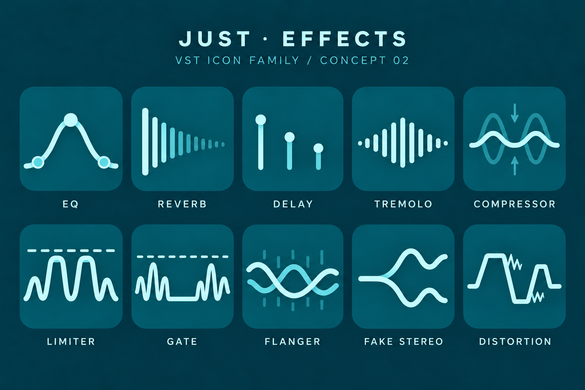

# README 头图候选 / Header preview

待 §9.2 所有者确认后才放入两份首页。这里使用仓库现有图片，不创建新美术。
Pending the owner's choice under plan §9.2. Only existing repository images are used.

## A — 图标总览 / Icon board

原图 1536 × 1024；下方按宽 720、高 480 展示。它包含原始 “CONCEPT 02” 和 “FAKE STEREO” 标签，Wider 兼容名称解释仍需保留。
Original size: 1536 × 1024; shown below at 720 × 480. The original “CONCEPT 02” and “FAKE STEREO” labels remain.

## B — 十款小图标 / Ten small icons

每个宽 40。它占用更少的首页高度；仅作为候选，不据此替所有者决定。
Each is 40 pixels wide. This takes less space above the introduction; it remains a candidate.

         

首页当前先保留标题、下载入口和插件表格图标，头图位置以 HTML 注释标记。两份首页应同时采用最终选择。
The README drafts currently show the title, downloads and plugin-table icons, with an HTML comment for the pending header. Apply the final choice to both languages together.
